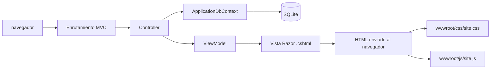

# Guía de estructura de HeroQuest

Este documento explica cómo está organizado el proyecto y cómo viajan los datos desde los CSV y SQLite hasta las páginas MVC. Está pensado como mapa de referencia para estudiar y modificar la aplicación.

> **Regla de mantenimiento:** cuando se añadan, eliminen o cambien carpetas o archivos importantes, actualiza esta guía para que siga describiendo el proyecto real.

Los documentos de estudio están agrupados aquí: este mapa MVC y `.StudyGuide/VISUALIZACION.md`, que explica el CSS modular y los temas.

## 1. Vista general

El proyecto usa **ASP.NET Core MVC**: el navegador pide una página, un controlador consulta la base de datos y una vista Razor genera el HTML.



El inicio de la aplicación prepara primero la base de datos y carga los CSV:

```text
Program.cs
   ├─ aplica las migraciones pendientes
   ├─ importa los héroes
   ├─ importa monstruos, objetos, habilidades y hechizos
   └─ inicia el servidor web
```

## 2. Mapa de carpetas

| Carpeta | Para qué sirve |
| --- | --- |
| `Controllers/` | Recibe las rutas web, consulta datos y aplica permisos. `PlayersController` solo permite al Maestro crear/editar cuentas de jugadores; `PlayerLibraryController` limita a cada Aventurero a sus propias configuraciones. |
| `.StudyGuide/` | Guías para estudiar el mapa MVC, la autenticación y la organización visual del CSS. |
| `Data/` | Configura Entity Framework Core y guarda los CSV fuente. |
| `Migrations/` | Historial de cambios del esquema de SQLite. |
| `Models/` | Entidades que representan personajes y registros de la base de datos. |
| `Services/` | Importación, lectura y transformación de datos. `HeroConfigurationService` calcula equipo y estadísticas personales, valida restricciones y compara con la ficha de referencia; `PasswordHashing` protege contraseñas; `EquipmentEffectParser` extrae efectos claros de las descripciones. |
| `Views/` | Plantillas Razor que generan cada página HTML. |
| `wwwroot/` | Archivos estáticos que descarga el navegador: CSS, JavaScript e imágenes. |
| `Properties/` | Perfiles de ejecución local, incluidos HTTP, HTTPS y red local. |

`Services/DatabaseBackupService.cs` crea copias semanales verificadas en `DataBase/Backups/` y conserva las ocho más recientes. La carpeta se excluye de Git para evitar subir archivos SQLite grandes con cambios pequeños.

Las claves que protegen las cookies y formularios se guardan en `DataBase/DataProtectionKeys/`, fuera de Git. En Windows se cifran con DPAPI y permanecen estables entre reinicios.

Al ejecutar o compilar pueden aparecer `DataBase/`, `bin/` y `obj/`. `DataBase/HeroQuest.db` es la base SQLite local; `bin/` y `obj/` contienen resultados temporales de compilación. No son el código de las páginas.

## 3. Archivos de arranque y configuración

| Archivo | Función |
| --- | --- |
| `Program.cs` | Punto de entrada. Registra MVC y `ApplicationDbContext`, fija `DataBase/HeroQuest.db`, aplica migraciones, ejecuta importadores y configura rutas y archivos estáticos. |
| `HeroQuest.csproj` | Define que es una aplicación web para .NET 10, referencias como Entity Framework Core/SQLite y la copia de los CSV al compilar. |
| `HeroQuest.sln` | Solución que abre el proyecto en Visual Studio. |
| `appsettings.json` | Configuración general, como la cadena de conexión y niveles de registro. La ruta final de la base se ajusta también en `Program.cs`. |
| `appsettings.Development.json` | Configuración adicional para el entorno de desarrollo. |
| `Properties/launchSettings.json` | Direcciones y variables para iniciar la app desde Visual Studio o `dotnet run`. El perfil `lan` escucha en `0.0.0.0:5080` para móviles de la misma Wi‑Fi. |
| `dotnet-tools.json` | Herramientas locales de .NET disponibles para el repositorio; incluye el flujo de Entity Framework CLI. |
| `README.md` | Instrucciones para ejecutar el sitio y abrirlo gratis desde teléfonos de la misma red local. |
| `opencode.jsonc` | Configuración auxiliar de herramientas de desarrollo; no participa en el funcionamiento de la web. |

## 4. Base de datos y entidades

### `Data/ApplicationDbContext.cs`

Es el puente entre el código C# y SQLite. Sus `DbSet` representan las colecciones/tablas principales: `Heroes`, `Monsters`, `Miscellanea`, `EquipmentsAndArtifacts`, `MonsterAbilities`, `SpellsOfTerror`, `WorldPoems`, `PlayerProfiles` y `HeroConfigurations`.

En `OnModelCreating` se configura la herencia `Character` mediante **TPC** (*Table per Concrete Class*): héroes y monstruos se guardan en tablas concretas separadas. También se configuran la tabla puente `MonsterSpellOfTerror` y las relaciones entre perfiles de jugador y sus configuraciones personales.

### `Models/`

| Archivo | Qué representa |
| --- | --- |
| `Character.cs` | Propiedades comunes a los personajes, como clase, vida, dados de mente, ataque y defensa. |
| `IArchivable.cs` | Contrato compartido para ocultar y restaurar fichas sin borrarlas de SQLite. |
| `CharacterHeroe.cs` | Datos de referencia de un héroe: clase, estadísticas base, equipo original y expansión. Las posesiones y nombre de campaña viven en configuraciones separadas. |
| `PlayerProfile.cs` | Nombre, apodo opcional, nombre de acceso y hash de contraseña de una persona jugadora. |
| `HeroConfiguration.cs` | Estado personal de un héroe para un jugador: nombre elegido, varias armas, armaduras, objetos, habilidades, movimiento y progreso. |
| `CharacterMonster.cs` | Datos propios de un monstruo: movimiento máximo, facción, habilidad y enlaces a hechizos. |
| `EquipmentsAndArtifacts.cs` | Registro de equipo o artefacto; ambos se almacenan en una tabla y se distinguen por categoría. |
| `MiscellaneaItem.cs` | Objeto de la sección Miscelánea. |
| `MonsterAbility.cs` | Nombre, descripción y expansión de una habilidad de monstruo. |
| `SpellOfTerror.cs` | Nombre, descripción y expansión de un hechizo del Terror. |
| `MonsterSpellOfTerror.cs` | Tabla de unión con las claves de monstruo y hechizo. |
| `TypeAppears.cs` | Enum de expansiones. Está marcado como `[Flags]`, así que un registro puede pertenecer a varias. |
| `EnumDisplayExtensions.cs` | Convierte valores del enum en nombres legibles para las vistas. |
| `MonsterVisualExtensions.cs` | Símbolos, colores y textos de presentación/lore para facciones, habilidades y hechizos. |
| `ViewModels.cs` | Agrupa los datos que cada vista necesita, por ejemplo lista de registros y ficha seleccionada. No son tablas de la base. |
| `AccountViewModels.cs` | Modelos de formularios de acceso, edición, pestañas de configuraciones y listas de jugadores. |
| `ErrorViewModel.cs` | Datos mínimos que necesita la página de error. |

## 5. CSV e importación

Los ficheros fuente están en `Data/HeroQuest_csv/`:

| CSV | Contenido |
| --- | --- |
| `HeroQuest_Heroes.csv` | Héroes iniciales y sus datos. |
| `HeroQuest_Monsters.csv` | Catálogo general de monstruos. |
| `HeroQuest_MonstersCategoriesAbilities.csv` | Monstruos con facción, habilidades y expansiones; es la fuente principal del importador de monstruos. |
| `HeroQuest_MonsterAbilities.csv` | Catálogo de habilidades y sus descripciones. |
| `HeroQuest_SpellsOfTerror.csv` | Catálogo de hechizos del Terror. |
| `HeroQuest_Equipment.csv` / `HeroQuest_Artifacts.csv` | Equipo y artefactos, importados a la tabla común. |
| `HeroQuest_Miscellanea.csv` | Objetos variados. |

Los CSV son datos de entrada. Cambiar un modelo C# no cambia por sí solo los encabezados del CSV: el importador debe leer el nombre de columna correcto.

En el arranque actual, `Program.cs` pasa `HeroQuest_Heroes.csv` a `HeroeImportService` y después entrega la carpeta completa a `CsvImportService`. Este último usa `HeroQuest_MonstersCategoriesAbilities.csv` como fuente de monstruos; `HeroQuest_Monsters.csv` se conserva como archivo separado de referencia y no es el que se usa en ese paso.

### Servicios de importación

| Archivo | Responsabilidad |
| --- | --- |
| `Services/CsvRecordReader.cs` | Lee registros CSV y centraliza la conversión segura de texto y números. |
| `Services/HeroeImportServices.cs` | Lee el CSV de héroes, normaliza nombres y evita reemplazar el progreso de campaña de héroes ya existentes. |
| `Services/CsvImportService.cs` | Importa los demás catálogos y reconstruye los vínculos entre monstruos y hechizos. |
| `Services/MonsterCsvParsing.cs` | Normaliza nombres y limpia texto de monstruos proveniente del CSV. |
| `Services/TypeAppearsParser.cs` | Convierte nombres de expansiones del CSV en valores `TypeAppears`. |
| `Services/AlphabeticalIdService.cs` | Reordena IDs según el alfabeto español para que el índice pueda usar el ID como orden. |

## 6. MVC: rutas, controladores y vistas

La ruta por defecto está definida en `Program.cs` con el patrón `{controller=Home}/{action=Index}/{id?}`. Por ejemplo, `/Heroes/Index/3` solicita el índice de héroes con el registro 3 seleccionado.

| Ruta/controlador | Datos que carga | Vista |
| --- | --- | --- |
| `/` o `/Home/Index` — `HomeController` | Recuentos y, para el Maestro de Juego, el registro de jugadores. | `Views/Home/HomeIndex.cshtml` |
| `/Players/Create` — `PlayersController` | Añade un jugador con nombre, apodo y vínculo opcional a un héroe; solo Admin. | Formulario de `Views/Home/HomeIndex.cshtml` |
| `/Heroes/Index/{id?}` — `HeroesController` | Héroes y héroe seleccionado. | `Views/Heroes/HeroesIndex.cshtml` |
| `/Monsters/Index/{id?}` — `MonstersController` | Monstruos, habilidades, hechizos y vínculos relacionados. | `Views/Monsters/MonstersIndex.cshtml` |
| `/Account/Login` — `AccountController` | Valida las cuentas de prueba y crea una cookie de sesión con rol User o Admin. | `Views/Account/Login.cshtml` |
| `/Admin/Index?type=...` — `AdminController` | Herramientas de catálogo protegidas en servidor con el rol Admin. Incluye alta, edición, borrado y archivado reversible. | `Views/Admin/Index.cshtml` y `Edit.cshtml` |
| `/Storehouse/Equipment/{id?}` — `StorehouseController` | Equipo y artefactos de la tabla compartida. | `Views/Storehouse/EquipmentIndex.cshtml` |
| `/Storehouse/Miscellanea/{id?}` — `StorehouseController` | Objetos de Miscelánea. | `Views/Storehouse/MiscellaneaIndex.cshtml` |

Un controlador no suele escribir el HTML directamente. Carga entidades con EF Core, construye un ViewModel y lo entrega a `View(...)`.

### `Views/`

- `_ViewStart.cshtml` selecciona el layout compartido para las vistas.
- `_ViewImports.cshtml` habilita Tag Helpers y espacios de nombres comunes.
- `Shared/_Layout.cshtml` contiene la estructura común: cabecera, navegación, pie, diálogo emergente y referencias a CSS/JavaScript.
- `Shared/_HeroDetailCard.cshtml`, `_MonsterDetailCard.cshtml`, `_EquipmentDetailCard.cshtml` y `_MiscellaneaDetailCard.cshtml` son parciales: pequeñas fichas reutilizables dentro de sus índices.
- `Shared/Error.cshtml` muestra la página de error.
- `Home/Privacy.cshtml` es la página de privacidad del proyecto.
- Los índices contienen la lista seleccionable y plantillas de ficha. `site.js` cambia la ficha en el navegador sin volver a pedir la página completa.

## 7. Interfaz: CSS, JavaScript e imágenes

| Archivo/carpeta | Función |
| --- | --- |
| `wwwroot/css/site.css` | Índice breve que importa los módulos CSS en el orden adecuado. |
| `wwwroot/css/modules/` | Estilos separados para base, portada, catálogos, mapa, formularios, temas y móviles. |
| `wwwroot/js/site.js` | Búsqueda y orden de índices, filtros, selección de fichas, tooltips y ventanas emergentes. |
| `wwwroot/images/heroquest/` | Ilustraciones SVG usadas por las fichas y la portada. |
| `wwwroot/favicon.ico` | Icono de la pestaña del navegador. |

Todo lo que el navegador debe descargar (CSS, JavaScript e imágenes) tiene que estar bajo `wwwroot/`.

## 8. Migraciones y cambios de esquema

`Migrations/` conserva el historial de cambios de tablas y columnas. `AddPlayerProfiles` crea la tabla de jugadores; `AddPlayerHeroConfigurations` convierte sus asociaciones antiguas en fichas personales y añade efectos numéricos para equipo; `RemoveLegacyHeroPlayerField` retira el campo de jugador que ya no se usa en `Heroes`. `AddCharacterSourceNames` guarda el nombre de origen para recuperar valores de referencia. Cada migración incluye:

- Un archivo principal `.cs` con los pasos `Up` (aplicar) y `Down` (revertir).
- Un `.Designer.cs` generado con el modelo de esa versión.
- `ApplicationDbContextModelSnapshot.cs`, que representa el modelo más reciente conocido por EF Core.

Al iniciar, `Program.cs` ejecuta `Database.MigrateAsync()`, que aplica las migraciones pendientes a la base local. **No borres migraciones antiguas para corregir un cambio de modelo**: crea una migración nueva para que la base existente pueda actualizarse. Los archivos `.Designer.cs` y el snapshot normalmente los genera la herramienta de Entity Framework.

## 9. Recorrido de aprendizaje recomendado

1. Empieza en `Views/Home/HomeIndex.cshtml` y sigue el enlace de una sección.
2. Abre el controlador asociado y observa cómo consulta `ApplicationDbContext`.
3. Revisa el ViewModel que entrega a la vista.
4. Sigue la vista `.cshtml` hasta su parcial en `Views/Shared/`.
5. Cambia una etiqueta o estilo en `wwwroot/css/site.css` y recarga la página.
6. Para un cambio de datos, sigue el CSV → servicio importador → modelo → DbContext → controlador → vista.

### Acceso, administración y temas

- `Program.cs` registra autenticación por cookie y autorización por roles. `app.UseAuthentication()` debe ir antes de `app.UseAuthorization()`.
- `appsettings.json` guarda los hashes de dos cuentas de demostración locales: `user` (solo lectura) y `admin` (gestión). `AccountController` comprueba la contraseña mediante PBKDF2. No reutilices estas cuentas en un sitio público.
- Las acciones de `AdminController` exigen el rol Admin también en el servidor. No basta con ocultar los botones en Razor.
- `IsArchived` se guarda en SQLite y una migración lo añade a las tablas. Archivar oculta; eliminar borra definitivamente.
- La elección del tema se guarda en `localStorage` del navegador; es independiente para cada dispositivo.
- Al añadir o quitar archivos de estudio, vistas o módulos CSS, actualiza este mapa y `.StudyGuide/VISUALIZACION.md` cuando corresponda.

Así puedes ver separadas las responsabilidades: **Model** representa los datos, **View** los presenta y **Controller** coordina la petición.

## Roles, Biblioteca y versos

- Las credenciales de demo se mantienen como `user / user123` y `admin / admin123`; dentro de la interfaz aparecen como **Aventurero** y **Maestro de Juego**.
- La **Biblioteca** es el espacio del Maestro de Juego para crear y editar fichas. Muestra primero las fichas activas y al final de la misma página las archivadas; el Aventurero no puede verlas.
- `Models/WorldPoem.cs` define versos con una clave, título, texto y estado de archivo. `AddWorldPoems` crea la tabla y `AddArchiveToWorldPoems` añade el archivado; `WorldPoemService` conserva los versos iniciales y `PoemsController` sirve los que están activos.
- `AlphabeticalIdService` ordena las fichas de personaje por nombre y asigna IDs impares a Héroes y pares a Monstruos. Al crear manualmente una ficha también se respeta esa paridad.


- La Biblioteca tiene estantes para Héroes, Monstruos, Equipo y Artefactos, Miscelánea, Habilidades, Hechizos del Terror y Versos y Leyendas. Los campos de catálogo usan buscadores con sugerencias y una lista de selecciones; cada campo existente se modifica por separado con su botón **Editar**.
- Las fichas de Héroes y Monstruos importadas conservan `SourceName`. El botón **Restablecer valores originales** recupera clases, atributos y equipo inicial desde los CSV de referencia y avisa antes de reemplazar cambios de balance.
- `PlayerProfile` guarda el nombre, apodo opcional, usuario y hash de contraseña. Cada jugador puede tener una configuración por héroe en `HeroConfigurations`; allí se conserva el nombre personalizado, equipo, habilidades y progreso. La migración inicial traslada la asociación histórica y conserva su héroe y equipo.

# Cambios de Biblioteca, categorías y equipo

## Miscelánea: nombre y procedencia

`Models/MiscellaneaCategory.cs` define etiquetas `[Flags]`: un objeto puede ser a la vez de **Alquimia** y **Mercado negro**, o exclusivo de una clase. Si no lleva etiqueta, se interpreta como objeto de la **Tienda normal**. `MiscellaneaItem.Category` guarda esa combinación como una máscara numérica; en `HeroQuest_Miscellanea.csv`, la nueva columna `Categoría` conserva el mismo valor.

Al iniciar, la migración `AddMiscellaneaCategories` añade la columna, asigna categorías a los objetos existentes y limpia del nombre etiquetas finales como `(Mercado Negro)`, `(Tesoro)`, `(Alquimia)` y `(Elfo)`. La vista `Views/Storehouse/MiscellaneaIndex.cshtml` permite filtrar el mismo catálogo por secciones; las etiquetas pueden solaparse intencionadamente.

## Biblioteca y fichas archivadas

`Views/Admin/_LibraryCatalogList.cshtml` contiene búsqueda, orden y filtros por expansión y clasificación. Sus filas se presentan como lomos de libros y muestran detalles sin IDs numéricos. En Héroes la clasificación es el jugador con configuración activa, cargado en `AdminController`. Al editar un héroe, los marcadores laterales abren la ficha por defecto o la configuración personal elegida; el símbolo `+` agrupa las restantes. Los cambios personales se guardan por AJAX y recalculan las estadísticas y flechas sin volver a cargar la página. `Views/Shared/_SearchPicker.cshtml` es el selector común para formularios de Biblioteca y de Aventurero; al vivir en `Shared`, puede usarse desde cualquier controlador.

La página pública `Heroes/Index` siempre ofrece las fichas de referencia activas de todos los héroes. Solo el Maestro de Juego tiene enlaces de edición desde esa vista; las configuraciones por jugador se abren desde Biblioteca o `PlayerLibrary`.

Las habilidades y hechizos archivados mantienen su relación con los monstruos. `MonstersController` los carga junto con los activos para conservar el nombre; `_MonsterDetailCard.cshtml` muestra que la información está archivada sin incluir la descripción. El Maestro de Juego ve el enlace para abrir esa ficha en Biblioteca y puede restaurarla desde su formulario.

## Jugador y nombre del héroe de campaña

El Maestro crea y edita perfiles desde el apartado de jugadores de Inicio. Cada alta crea también una cuenta de rol `User`; el usuario inicial se genera a partir del nombre y la contraseña provisional es `<usuario>123`. Por ejemplo, Pol accede con `pol / pol123`. Si no se indica un nombre propio al crear la primera configuración, se usa el apodo y, si no hay apodo, el nombre del jugador. Los cambios posteriores en el nombre del héroe no alteran los datos del jugador.

## Armas, armaduras y dados

`EquipmentEffectParser` vuelve a leer las descripciones al iniciar y guarda efectos estructurados en SQLite (dados de ataque/defensa, restricciones de clase, movimiento y compatibilidades). En una ficha personal, las armas sustituyen el ataque de referencia y se usa el valor más alto de las armas equipadas; las armaduras usan su mayor valor defensivo. El Aventurero no puede modificar directamente clase ni estadísticas base. Las restricciones se validan también en el servidor, no solo en los controles visuales. La respuesta AJAX devuelve los valores recalculados a `site.js`, que actualiza la ficha y sus indicadores sin recargarla.

La interfaz de selección de jugadores en Inicio usa un panel plegable para que las clases disponibles no ocupen toda la pantalla. El nombre de acceso y su contraseña inicial se generan en el servidor, pero no se muestran en el listado. `responsive.css` conserva el índice visible y desplazable en móvil y adapta los lomos de libros y los formularios a pantallas estrechas.
