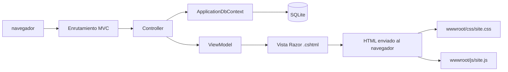

# Guía de estructura de HeroQuest

Este documento explica cómo está organizado el proyecto y cómo viajan los datos desde los CSV y SQLite hasta las páginas MVC. Está pensado como mapa de referencia para estudiar y modificar la aplicación.

> **Regla de mantenimiento:** cuando se añadan, eliminen o cambien carpetas o archivos importantes, actualiza esta guía para que siga describiendo el proyecto real.

## 1. Vista general

El proyecto usa **ASP.NET Core MVC**: el navegador pide una página, un controlador consulta la base de datos y una vista Razor genera el HTML.



El inicio de la aplicación prepara primero la base de datos y carga los CSV:

```text
Program.cs
   ├─ aplica las migraciones pendientes
   ├─ importa los héroes
   ├─ importa monstruos, objetos, habilidades y hechizos
   └─ inicia el servidor web
```

## 2. Mapa de carpetas

| Carpeta | Para qué sirve |
| --- | --- |
| `Controllers/` | Recibe las rutas web, consulta datos y elige qué vista mostrar. |
| `Data/` | Configura Entity Framework Core y guarda los CSV fuente. |
| `Migrations/` | Historial de cambios del esquema de SQLite. |
| `Models/` | Entidades que representan personajes y registros de la base de datos. |
| `Services/` | Importación, lectura y transformación de datos. |
| `Views/` | Plantillas Razor que generan cada página HTML. |
| `wwwroot/` | Archivos estáticos que descarga el navegador: CSS, JavaScript e imágenes. |
| `Properties/` | Perfiles de ejecución local, incluidos HTTP, HTTPS y red local. |

Al ejecutar o compilar pueden aparecer `DataBase/`, `bin/` y `obj/`. `DataBase/HeroQuest.db` es la base SQLite local; `bin/` y `obj/` contienen resultados temporales de compilación. No son el código de las páginas.

## 3. Archivos de arranque y configuración

| Archivo | Función |
| --- | --- |
| `Program.cs` | Punto de entrada. Registra MVC y `ApplicationDbContext`, fija `DataBase/HeroQuest.db`, aplica migraciones, ejecuta importadores y configura rutas y archivos estáticos. |
| `HeroQuest.csproj` | Define que es una aplicación web para .NET 10, referencias como Entity Framework Core/SQLite y la copia de los CSV al compilar. |
| `HeroQuest.sln` | Solución que abre el proyecto en Visual Studio. |
| `appsettings.json` | Configuración general, como la cadena de conexión y niveles de registro. La ruta final de la base se ajusta también en `Program.cs`. |
| `appsettings.Development.json` | Configuración adicional para el entorno de desarrollo. |
| `Properties/launchSettings.json` | Direcciones y variables para iniciar la app desde Visual Studio o `dotnet run`. El perfil `lan` escucha en `0.0.0.0:5080` para móviles de la misma Wi‑Fi. |
| `dotnet-tools.json` | Herramientas locales de .NET disponibles para el repositorio; incluye el flujo de Entity Framework CLI. |
| `README.md` | Instrucciones para ejecutar el sitio y abrirlo gratis desde teléfonos de la misma red local. |
| `opencode.jsonc` | Configuración auxiliar de herramientas de desarrollo; no participa en el funcionamiento de la web. |

## 4. Base de datos y entidades

### `Data/ApplicationDbContext.cs`

Es el puente entre el código C# y SQLite. Sus `DbSet` representan las colecciones/tablas principales: `Heroes`, `Monsters`, `Miscellanea`, `EquipmentsAndArtifacts`, `MonsterAbilities` y `SpellsOfTerror`.

En `OnModelCreating` se configura la herencia `Character` mediante **TPC** (*Table per Concrete Class*): héroes y monstruos se guardan en tablas concretas separadas. También se configura la relación entre monstruos y hechizos del Terror mediante la tabla puente `MonsterSpellOfTerror`.

### `Models/`

| Archivo | Qué representa |
| --- | --- |
| `Character.cs` | Propiedades comunes a los personajes, como clase, vida, dados de mente, ataque y defensa. |
| `CharacterHeroe.cs` | Datos propios de un héroe: movimiento con dados rojos, equipo, oro y otros datos de campaña. |
| `CharacterMonster.cs` | Datos propios de un monstruo: movimiento máximo, facción, habilidad y enlaces a hechizos. |
| `EquipmentsAndArtifacts.cs` | Registro de equipo o artefacto; ambos se almacenan en una tabla y se distinguen por categoría. |
| `MiscellaneaItem.cs` | Objeto de la sección Miscelánea. |
| `MonsterAbility.cs` | Nombre, descripción y expansión de una habilidad de monstruo. |
| `SpellOfTerror.cs` | Nombre, descripción y expansión de un hechizo del Terror. |
| `MonsterSpellOfTerror.cs` | Tabla de unión con las claves de monstruo y hechizo. |
| `TypeAppears.cs` | Enum de expansiones. Está marcado como `[Flags]`, así que un registro puede pertenecer a varias. |
| `EnumDisplayExtensions.cs` | Convierte valores del enum en nombres legibles para las vistas. |
| `MonsterVisualExtensions.cs` | Símbolos, colores y textos de presentación/lore para facciones, habilidades y hechizos. |
| `ViewModels.cs` | Agrupa los datos que cada vista necesita, por ejemplo lista de registros y ficha seleccionada. No son tablas de la base. |
| `ErrorViewModel.cs` | Datos mínimos que necesita la página de error. |

## 5. CSV e importación

Los ficheros fuente están en `Data/HeroQuest_csv/`:

| CSV | Contenido |
| --- | --- |
| `HeroQuest_Heroes.csv` | Héroes iniciales y sus datos. |
| `HeroQuest_Monsters.csv` | Catálogo general de monstruos. |
| `HeroQuest_MonstersCategoriesAbilities.csv` | Monstruos con facción, habilidades y expansiones; es la fuente principal del importador de monstruos. |
| `HeroQuest_MonsterAbilities.csv` | Catálogo de habilidades y sus descripciones. |
| `HeroQuest_SpellsOfTerror.csv` | Catálogo de hechizos del Terror. |
| `HeroQuest_Equipment.csv` / `HeroQuest_Artifacts.csv` | Equipo y artefactos, importados a la tabla común. |
| `HeroQuest_Miscellanea.csv` | Objetos variados. |

Los CSV son datos de entrada. Cambiar un modelo C# no cambia por sí solo los encabezados del CSV: el importador debe leer el nombre de columna correcto.

En el arranque actual, `Program.cs` pasa `HeroQuest_Heroes.csv` a `HeroeImportService` y después entrega la carpeta completa a `CsvImportService`. Este último usa `HeroQuest_MonstersCategoriesAbilities.csv` como fuente de monstruos; `HeroQuest_Monsters.csv` se conserva como archivo separado de referencia y no es el que se usa en ese paso.

### Servicios de importación

| Archivo | Responsabilidad |
| --- | --- |
| `Services/CsvRecordReader.cs` | Lee registros CSV y centraliza la conversión segura de texto y números. |
| `Services/HeroeImportServices.cs` | Lee el CSV de héroes, normaliza nombres y evita reemplazar el progreso de campaña de héroes ya existentes. |
| `Services/CsvImportService.cs` | Importa los demás catálogos y reconstruye los vínculos entre monstruos y hechizos. |
| `Services/MonsterCsvParsing.cs` | Normaliza nombres y limpia texto de monstruos proveniente del CSV. |
| `Services/TypeAppearsParser.cs` | Convierte nombres de expansiones del CSV en valores `TypeAppears`. |
| `Services/AlphabeticalIdService.cs` | Reordena IDs según el alfabeto español para que el índice pueda usar el ID como orden. |

## 6. MVC: rutas, controladores y vistas

La ruta por defecto está definida en `Program.cs` con el patrón `{controller=Home}/{action=Index}/{id?}`. Por ejemplo, `/Heroes/Index/3` solicita el índice de héroes con el registro 3 seleccionado.

| Ruta/controlador | Datos que carga | Vista |
| --- | --- | --- |
| `/` o `/Home/Index` — `HomeController` | Recuentos para la portada. | `Views/Home/HomeIndex.cshtml` |
| `/Heroes/Index/{id?}` — `HeroesController` | Héroes y héroe seleccionado. | `Views/Heroes/HeroesIndex.cshtml` |
| `/Monsters/Index/{id?}` — `MonstersController` | Monstruos, habilidades, hechizos y vínculos relacionados. | `Views/Monsters/MonstersIndex.cshtml` |
| `/Archive/Equipment/{id?}` — `ArchiveController` | Equipo y artefactos de la tabla compartida. | `Views/EquipmentsArtifacts/Index.cshtml` |
| `/Archive/Miscellanea/{id?}` — `ArchiveController` | Objetos de Miscelánea. | `Views/Miscellanea/Index.cshtml` |

Un controlador no suele escribir el HTML directamente. Carga entidades con EF Core, construye un ViewModel y lo entrega a `View(...)`.

### `Views/`

- `_ViewStart.cshtml` selecciona el layout compartido para las vistas.
- `_ViewImports.cshtml` habilita Tag Helpers y espacios de nombres comunes.
- `Shared/_Layout.cshtml` contiene la estructura común: cabecera, navegación, pie, diálogo emergente y referencias a CSS/JavaScript.
- `Shared/_HeroDetailCard.cshtml`, `_MonsterDetailCard.cshtml`, `_EquipmentDetailCard.cshtml` y `_MiscellaneaDetailCard.cshtml` son parciales: pequeñas fichas reutilizables dentro de sus índices.
- `Shared/Error.cshtml` muestra la página de error.
- `Home/Privacy.cshtml` es la página de privacidad del proyecto.
- Los índices contienen la lista seleccionable y plantillas de ficha. `site.js` cambia la ficha en el navegador sin volver a pedir la página completa.

## 7. Interfaz: CSS, JavaScript e imágenes

| Archivo/carpeta | Función |
| --- | --- |
| `wwwroot/css/site.css` | Tema visual tipo libro antiguo, tarjetas, tamaños y ajustes responsive para móviles. |
| `wwwroot/js/site.js` | Búsqueda y orden de índices, filtros, selección de fichas, tooltips y ventanas emergentes. |
| `wwwroot/images/heroquest/` | Ilustraciones SVG usadas por las fichas y la portada. |
| `wwwroot/favicon.ico` | Icono de la pestaña del navegador. |

Todo lo que el navegador debe descargar (CSS, JavaScript e imágenes) tiene que estar bajo `wwwroot/`.

## 8. Migraciones y cambios de esquema

`Migrations/` conserva el historial de cambios de tablas y columnas. Cada migración incluye:

- Un archivo principal `.cs` con los pasos `Up` (aplicar) y `Down` (revertir).
- Un `.Designer.cs` generado con el modelo de esa versión.
- `ApplicationDbContextModelSnapshot.cs`, que representa el modelo más reciente conocido por EF Core.

Al iniciar, `Program.cs` ejecuta `Database.MigrateAsync()`, que aplica las migraciones pendientes a la base local. **No borres migraciones antiguas para corregir un cambio de modelo**: crea una migración nueva para que la base existente pueda actualizarse. Los archivos `.Designer.cs` y el snapshot normalmente los genera la herramienta de Entity Framework.

## 9. Recorrido de aprendizaje recomendado

1. Empieza en `Views/Home/HomeIndex.cshtml` y sigue el enlace de una sección.
2. Abre el controlador asociado y observa cómo consulta `ApplicationDbContext`.
3. Revisa el ViewModel que entrega a la vista.
4. Sigue la vista `.cshtml` hasta su parcial en `Views/Shared/`.
5. Cambia una etiqueta o estilo en `wwwroot/css/site.css` y recarga la página.
6. Para un cambio de datos, sigue el CSV → servicio importador → modelo → DbContext → controlador → vista.

Así puedes ver separadas las responsabilidades: **Model** representa los datos, **View** los presenta y **Controller** coordina la petición.
